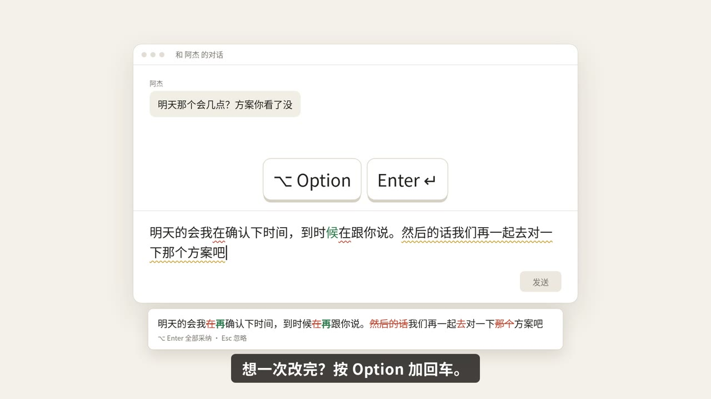
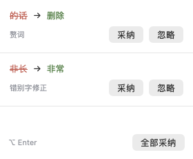
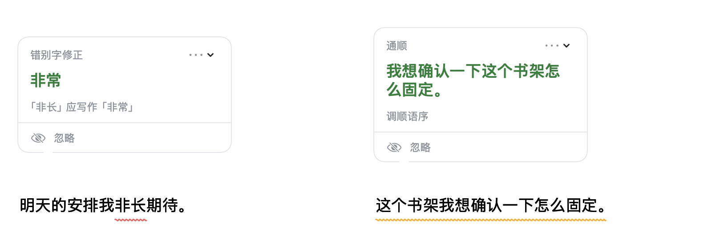
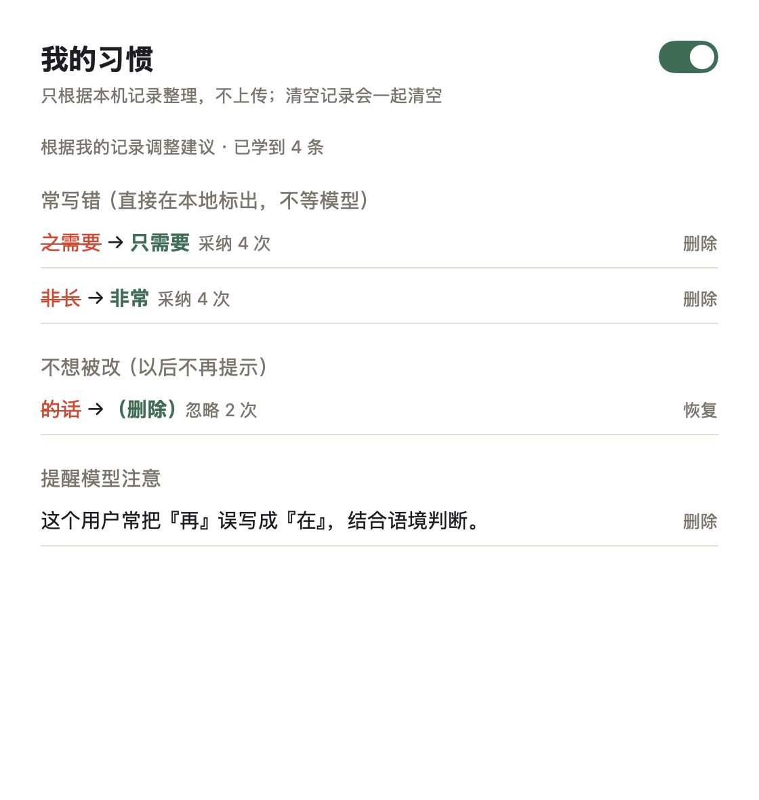
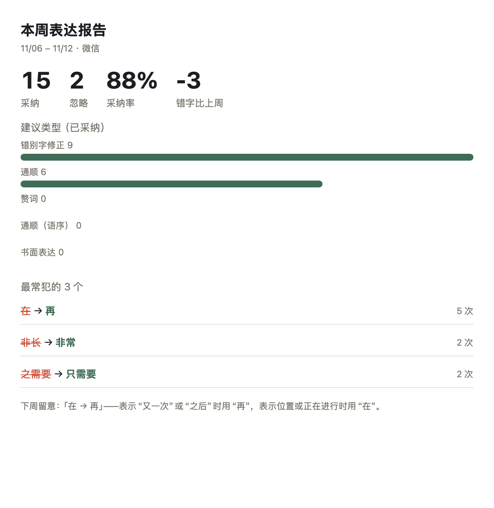

#  StylePolish

A macOS writing assistant that polishes text while keeping your voice; you stay in control of sending. WeChat is enabled by default. You can enable other apps in Settings; writeback may fail in unverified apps. Automatic checks and shortcuts only run in enabled apps.

默认在 macOS 微信里使用（`com.tencent.xinWeChat`），其他 App 可以在设置里打开（未验证的可能写回失败）。停笔后帮你润色，保留你的口吻，发送仍由你自己按。自动检查、快捷键和写回只针对已启用的 App。

**▶ 30 秒宣传片**（点图片播放）：

<a href="docs/media/promo.mp4"></a>



*合成界面示意。输入框兼容性见下方限制。*

## 它做什么

小改（错字、用错的词）在原文下画线，点开采纳；需要理顺时，底部预览改好的整段，⌥Enter 替换。继续输入会作废旧建议，Esc 忽略。不自动发送。

「我的习惯」按采纳和忽略记录调整提醒：同一错字采纳 2 次且未忽略后，多字错写在本地直接标出，单字交给模型结合语境判断。同一建议忽略 2 次且未采纳后不再提示，可在设置里恢复，也可整体关闭习惯功能；习惯和报告只读本机记录，不调用模型学习。菜单「本周表达报告」可看最近七天的采纳率、已采纳错字纠正与前七天的对比、最常见的三个错字和下周留意。

“My Habits” adjusts suggestions from your accept/ignore history: after the same typo is accepted twice with no ignores, multi-character mistakes are flagged locally, while single-character mistakes go to the model for context. Suggestions ignored twice with no accepts stop appearing; restore them in settings or turn habits off entirely, with habits and reports built only from local records and no model calls for learning. The menu’s “Weekly Expression Report” shows the last seven days’ acceptance rate, accepted typo corrections compared with the previous seven days, the three most frequent mistakes and a tip for next week.

## 安装

需要 macOS 13+。从 [GitHub Releases](https://github.com/bmdy6/stylepolish/releases/latest) 下载适合本机架构的 zip，解压后**先把 App 拖进「应用程序」再打开，不要在下载文件夹里直接双击**。
没有 Apple 公证，第一次打开要右键 → 打开；信任来源后也可执行：

```sh
xattr -dr com.apple.quarantine /Applications/StylePolish.app
```

从源码构建需要 Swift 5.9+（Xcode Command Line Tools）：

```sh
git clone https://github.com/bmdy6/stylepolish
cd stylepolish
swift test
scripts/build-app.sh
```

产物为 `dist/StylePolish.app`。有本机专用签名身份时使用它，否则自动 `codesign -s -`（ad-hoc），无需作者证书。
首次构建不会创建钥匙串；可选运行 `scripts/setup-signing.sh` 创建空密码的专用签名钥匙串和本机自签名证书，并配置非交互 codesign 权限，不访问登录钥匙串。详见 [使用说明](docs/USAGE.md)。

## 第一次使用

第一次打开会走三步引导：授权辅助功能 → 选润色方式 → 在窗口里试一句。授权会每秒自动检测；已有授权会直接进入第二步。菜单「使用说明…」和设置「重新打开引导」都能再打开。

<!-- readme-illustrate:inline-suggestions -->


错字和通顺建议。以下四图均为离屏渲染，合成数据；[来源与限制](docs/images/SOURCES.md)。
<!-- /readme-illustrate:inline-suggestions -->
<!-- readme-illustrate:sentence-preview -->


整句预览：红删绿增，⌥Enter 全部采纳，Esc 忽略。
<!-- /readme-illustrate:sentence-preview -->
- **本地规则**：没读到 Key 时默认使用，免费、不联网。检查常见错写、白名单里的重复虚词/词、重复标点和个人词表 `aliases`；严格档额外检查中文间的半角逗号。不改写句子，不检查英文，不做通用叠字检测，也不用需要语境的 `contextual_aliases`。引用/代码字面保守跳过。
- **邀请码**：由作者手动发放，验证后可试用 AI 润色。文字及可选口吻档案、词表会经过作者服务器转发给模型；中转不保存正文。设置里显示剩余百分比，低于 10% 时菜单提醒一次；码无效、额度用完或当月试用已满时改用本地规则，并给出更换邀请码 / 使用自己的 Key 的入口。网络失败、限速、输入过长只回退当次，下次照常重试。
- **自己的 Key**：已有 Key 的用户保持 AI，可在设置切换。文字会发给你配置的 OpenAI 兼容服务。请求失败时当次自动用本地规则，菜单显示 Key、额度或网络原因；下次停笔仍重试 AI。

试用中转默认地址目前为占位值 `https://relay.invalid`，服务尚未开放；邀请码选项仍可见，验证时提示「试用服务还没开放」。上线后可在高级设置修改中转地址。邀请码单独保存在 `~/.config/stylepolish/invite.json`，首次启动生成的设备 UUID 保存在同目录的 `device-id`，文件权限均为 `0600`，不进入钥匙串，也不放入 UserDefaults。试用请求只发送邀请码和设备 UUID，不发送自己的 API Key。

设置里的「在哪些 App 里使用」可以勾选、移除 App，或添加正在运行的 App。默认只勾微信，未验证的 App 会标注写回风险。设置分为「润色方式」「在哪些 App 里使用」「权限与说明」「高级」。接口地址、模型、速度、vault Key 名称、口吻档案、个人词表和 ⌥Space 备用弹窗都在高级中。Key 明文保存在 `~/.config/stylepolish/openai-key`，文件权限 `0600`、目录 `0700`；可选读取 `~/.config/ai-vault/vault.json` 的 `OPENAI_PLATFORM_API_KEY`，优先于本地文件，不访问登录钥匙串。

<!-- readme-illustrate:my-habits -->


「我的习惯」：本地纠错、忽略后的恢复、语境提醒和总开关。
<!-- /readme-illustrate:my-habits -->
<!-- readme-illustrate:weekly-report -->


「本周表达报告」：最近七天的采纳、忽略、错字对比与下周留意。
<!-- /readme-illustrate:weekly-report -->
升级后如果菜单显示「需要授权」，通常是签名变化使旧授权失效。点击状态打开引导，进入系统设置 → 隐私与安全性 → 辅助功能；旧条目开关无效时先选中点「−」移除，再点「+」添加 `/Applications/StylePolish.app`。检测到授权后会自动继续。
## 隐私

本地规则不发送文字；「自己的 Key」模式的文字及可选口吻档案、词表发送给你配置的接口；邀请码模式则经过作者服务器转发给模型，中转不保存正文。请核对接收服务的隐私政策。
手改及采纳、忽略等记录只存在本机 `~/Library/Application Support/StylePolish/history.jsonl`（`0600`），包含原文和改写，可在设置中清空。
除模型请求及邀请码状态查询外，没有遥测或额外上传；本机历史不会上传。邀请码状态查询只发送邀请码和设备 UUID，不发送正文。
个人词表见 [合成模板](lexicon.example.json)，详细参数见 [使用说明](docs/USAGE.md)。

## 已知限制

- 长段「理顺」的效果还不稳定，默认模型主要擅长纠错。
- 默认只启用微信；其他 App 可以在设置里打开，未验证的可能写回失败，各版本和输入框的兼容性仍需逐项验证。
- 支持应用内更新的发布包可从菜单栏选择「检查更新…」，并确认安装。菜单没有更新入口的旧版本需手动下载替换一次。切换签名后可能需要重新授权辅助功能。
- 没有 Apple 公证；本机构建的 zip 仅包含构建机器的架构。

## 宣传片素材

- 背景音乐：[Upbeat Corporate](https://www.jamendo.com/track/1670486) — Soundrider/Dope，CC BY
- 配音：Microsoft Edge 在线音色 Xiaoyi（经 [edge-tts](https://github.com/rany2/edge-tts)）
- 画面：自制动画，聊天窗口为通用示意

## 许可证

[MIT License](LICENSE)。
